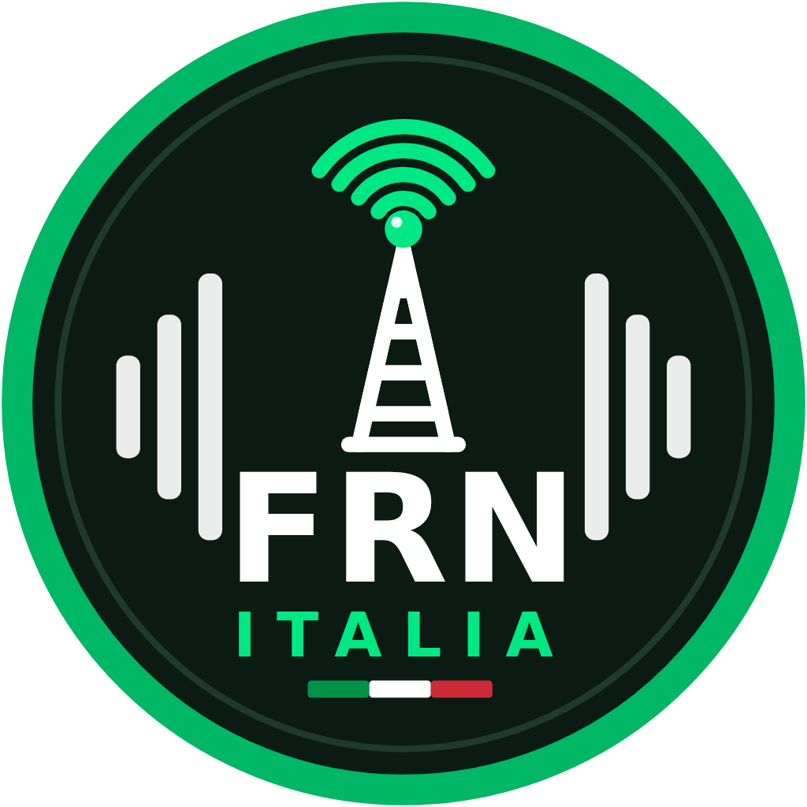

<p align="center">
  
</p>

<h1 align="center">KV4P FRN Gateway — FRN ITALIA</h1>

<p align="center">
  Modifica firmware della scheda <b>KV4P HT</b> per trasformarla in un <b>gateway Free Radio Network</b> autonomo.<br>
  Progetto della comunità <b>FRN ITALIA</b> — server <code>server.voip-italia.net</code>
</p>

<p align="center">
  <a href="https://t.me/frnitalia"></a>
  
  
</p>

> 💬 **Gruppo Telegram FRN ITALIA:** <https://t.me/frnitalia> — aggiornamenti, supporto e prove sul campo.

Firmware che trasforma una scheda **KV4P HT v1.x** (ESP32-WROOM-32 + SA818) in un
**gateway Free Radio Network completo**, senza PC e senza telefono: l'ESP32 si collega
al Wi-Fi, fa login sul server FRN come client di tipo *gateway* (`<CL>1</CL>`) e fa da
ponte fra la stanza FRN e la frequenza radio.

```
 radio ── SA818 ── ADC 48 kHz ─► 8 kHz ─► GSM 06.10 (WAV49) ─► TCP ─► server FRN
 radio ◄─ SA818 ◄─ DAC 48 kHz ◄─ 8 kHz ◄─ GSM 06.10 (WAV49) ◄─ TCP ◄─ server FRN
```

## Cosa fa

- Client FRN completo: login, liste client/net/messaggi, keepalive `P`, richiesta del
  turno `TX0` / `TX1` / `RX0`, ricezione voce, riconnessione automatica con backoff,
  server di backup, gestione login rifiutato (`WRONG`/`BLOCK`).
- Codec GSM 06.10 in formato WAV49 (libgsm), **bit-exact** con la libgsm usata da SvxLink.
- Gateway half-duplex: squelch del modulo (pin SQ) o VOX o entrambi, ritardo apertura,
  coda, ritardo PTT→audio, coda TX, blocco RX dopo TX, buffer anti-jitter,
  **time-out** in entrambe le direzioni, sicurezza PTT (se il task di rete si blocca il PTT viene rilasciato).
- **Toni di cortesia** ("coda" come un ponte radio), scegliendo fra 8 suoni:
  a fine di ogni QSO ricevuto da FRN, quando la tua trasmissione è davvero
  uscita su FRN (gateway impegnato) e, se vuoi, quando il gateway non ha preso la parola.
- **Cambio stanza con i toni DTMF**: dalla radio invii `#` più un codice (es. `#2`) e la
  stanza cambia; tabella codici → stanze configurabile, `#0` = stanza principale,
  ritorno automatico opzionale. I toni non vengono inoltrati in rete.
- **Identificativo CW** automatico del nominativo a fine passaggio (al massimo ogni N minuti).
- **Fino a 3 reti Wi-Fi** (casa, hotspot del cellulare, ufficio): si collega alla prima
  della lista che trova attiva e, se la rete cade, ricerca da sola.
- **Tipo stazione** selezionabile: Gateway (predefinito), Crosslink, PC Only.
- **Potenza alta/bassa** del modulo (serve il pin H/L collegato, vedi sotto).
- **Interfaccia web moderna** con tema scuro, chiaro o automatico, adatta anche al telefono:
  stato in tempo reale, misuratore di livello, log, configurazione a schede.
- Aggiornamento firmware via Wi-Fi (OTA) dalla pagina web.
- Access point di configurazione al primo avvio o se il Wi-Fi non è raggiungibile.

## Hardware

Nessuna modifica: pin presi dal firmware ufficiale kv4p-ht (profilo "V1").

| Segnale | GPIO | Note |
|---|---|---|
| SA818 UART | 16 (RX) / 17 (TX) | 9600 baud |
| PTT | 18 | LOW = trasmissione |
| PD | 19 | HIGH = acceso |
| SQ | 32 | HIGH = squelch chiuso |
| Audio dal modulo | 34 | ADC1 canale 6 (compatibile con il Wi-Fi) |
| Audio al modulo | 25 | DAC1 |
| Polarizzazione ingresso | 26 | DAC2, 1,75 V |
| LED | 2 | stato |
| BOOT | 0 | tenuto premuto 5 s all'accensione = reset di fabbrica |

**Potenza di trasmissione.** Sulla KV4P v1.x il pin H/L del modulo radio non è
collegato all'ESP32 (nella configurazione ufficiale della v1.5 `PIN_HL = -1`), quindi il
modulo lavora sempre in potenza alta (circa 1 W). Per regolare la potenza dalla pagina
web collega con un filo il pin H/L del modulo al **GPIO23** e scegli
*"GPIO23 con filo diretto"*: il firmware mette il pin a massa per la potenza bassa e lo
lascia libero per quella alta. Sulla KV4P v2.0 scegli *"tramite transistor"*.

Alimentazione: per un gateway fisso usa un alimentatore USB-C da 5 V / 2 A di qualità.
Il modulo in trasmissione assorbe picchi importanti.

## Compilazione e flash

1. Installa **VS Code** con l'estensione **PlatformIO**.
2. Apri questa cartella, cioè quella che contiene `platformio.ini`.
3. Collega la KV4P via USB e premi **Upload** (ambiente `kv4p`). Se non entra in
   programmazione, tieni premuto BOOT, premi RST e poi rilascia BOOT.
4. Apri il **Serial Monitor** a 115200 baud per seguire il log.

Gli aggiornamenti successivi si possono fare dalla pagina web (*Aggiornamento firmware*,
file `.pio/build/kv4p/firmware.bin`) oppure con `pio run -e kv4p-ota -t upload`.

## Primo avvio

1. Senza Wi-Fi configurato la scheda crea la rete **`FRN-GW-xxxx`** (password `frngateway`).
2. Collegati e apri **http://192.168.4.1/**. Utente `admin`, password `frngateway`.
3. Compila i campi:
   - **Wi-Fi**: fino a 3 reti in ordine di priorità. Cambia anche la password della pagina web.
   - **Server FRN**: `server.voip-italia.net`, porta `10024`, stanza `Nazionale`,
     e-mail e password FRN del gateway, nominativo, nome, città e nazione
     (tutti obbligatori: AlterFRN chiude la connessione se mancano).
   - **Radio**: modulo VHF o UHF, frequenza, CTCSS, squelch.
4. **Salva e riavvia**. Dopo un minuto di collegamento stabile l'access point si spegne.
   La pagina resta raggiungibile su `http://frn-gateway.local/` o sull'IP mostrato nel log.

Il campo `<BC>` viene generato in automatico (es. `145.50000FM CTC88.5`), ma si può
sovrascrivere.

## LED

| LED | Significato |
|---|---|
| lampeggio lento | Wi-Fi non connesso |
| lampeggio veloce | Wi-Fi ok, non loggato su FRN |
| acceso fisso | pronto |
| sfarfallio | traffico (radio→FRN o FRN→radio) |

## Taratura consigliata

1. **Squelch**: con il canale libero lo stato deve mostrare `segnale RX: no`. Trasmetti con
   un portatile: deve passare a `SI` e il gateway va in `RADIO->FRN`.
2. **Livello radio → FRN**: parla normalmente e regola `Guadagno radio → FRN` (e/o il
   volume del modulo) finché gli altri ti sentono a volume simile alle altre stazioni.
   `livello RX` dovrebbe stare tra circa 2000 e 8000 sui picchi.
3. **Livello FRN → radio**: ascolta il gateway con un portatile e regola
   `Guadagno FRN → radio` per una deviazione corretta, senza distorsione.
4. **Ritardo PTT → audio**: se si perde l'inizio delle frasi su radio con squelch lento o
   tono CTCSS, aumentalo (300–500 ms).
5. **clock ADC (Hz)** nello stato: dopo circa 10 s deve stabilizzarsi vicino a 48000. Il
   firmware misura il clock reale e corregge da solo la frequenza di campionamento.

## Cambio stanza con i DTMF

Nella scheda **DTMF** della pagina web associ un codice a ogni stanza (fino a 10), per esempio:

| Codice | Stanza |
|---|---|
| `#1` | Nazionale |
| `#2` | Prove |
| `#3` | Ham Radio Network |
| `#999` | Test |

Dalla radio premi il PTT, invia `#` e il codice con la tastiera DTMF, poi rilascia il PTT.
La fine del passaggio conferma il comando:

- **codice valido**: tre toni che salgono e il codice in CW, poi il gateway entra nella
  nuova stanza (servono pochi secondi per il nuovo login);
- **codice sconosciuto**: un tono basso che scende, nessun cambio;
- **`#0`** riporta sempre alla stanza principale, quella della scheda Server FRN;
- `*` durante il comando cancella le cifre inserite.

Appena il gateway riconosce il `#`, smette di inoltrare l'audio su FRN e restituisce la
parola: gli altri utenti non sentono i toni. Il cambio non viene salvato: al riavvio si
riparte dalla stanza principale. Se imposti *Ritorno alla stanza principale dopo N minuti*,
il gateway ci torna da solo dopo N minuti senza traffico. Il decodificatore DTMF è in
software (il modulo SA818 non ne ha uno) ed è testato contro voce, toni e rumore.

## Come funziona

- **task audio** (core 1): gestisce I2S0 in modalità ADC integrato (ricezione) oppure DAC
  integrato (trasmissione), il PTT, il ricampionamento 48↔8 kHz (FIR polifase a 144 tap)
  e la misura del livello.
- **task FRN** (core 0): client FRN e macchina a stati del gateway:
  `IDLE` → `RADIO->FRN` (squelch aperto: `TX0`, attesa del turno, invio pacchetti da
  200 ms) oppure `IDLE` → `FRN->RADIO` (arriva voce: PTT, ritardo, buffer anti-jitter,
  riproduzione, eventuale ID in CW, coda, rilascio).
- Il protocollo FRN segue il client verificato su un vero server AlterFRN r7348
  (repo FreeRadioNetwork, `client-pc/frnclient/protocol.py`), confrontato con SvxLink ModuleFrn.
  Dove differiscono vale il comportamento verificato su AlterFRN: keepalive `P` ogni secondo
  anche in trasmissione, `DT_IDLE` non tocca lo stato TX, login valido solo con
  `AL` = OK/OWNER/NETOWNER/ADMIN, risposta alla challenge `KP`, backup da `<BN>/<BP>`.

## Test

Le parti portabili (protocollo FRN, codec, DSP, CW) hanno test che girano sul PC:

```sh
./test/native/run.sh
```

Il server FRN viene simulato: login (anche frammentato byte per byte), liste, keepalive,
voce in arrivo, turno concesso e negato, concessione tardiva, login rifiutato, timeout,
backoff, server di backup, catena audio completa, ID in CW, toni di cortesia e decodifica DTMF. Risultato attuale:
**174 controlli, 0 errori**.

## Stato del progetto

Versione 0.4.1: **login e collegamento verificati sul server AlterFRN di Voip-Italia**
(stanza Prove, 18/11/2026). In corso la taratura audio. Da controllare in ogni installazione:

- Il clock reale dell'ADC I2S (viene misurato e corretto in automatico, ma controlla il valore).
- I livelli audio nei due versi (vedi *Taratura*).
- Se in ricezione senti disturbi quando il Wi-Fi trasmette, prova ad allontanare
  l'antenna radio dall'ESP32 o a ridurre la potenza Wi-Fi.

## Comunità e supporto

Il progetto nasce nella comunità **FRN ITALIA**: domande, segnalazioni e prove sul
gruppo Telegram <https://t.me/frnitalia>.

Basato sull'hardware open source [kv4p-ht](https://github.com/VanceVagell/kv4p-ht) di
Vance Vagell (KV4P), che ringraziamo.

## Licenze

- Codice del gateway: GPL-3.0, come kv4p-ht. Il protocollo segue SvxLink (GPL).
- `lib/gsm`: libgsm © 1992-1994 Jutta Degener e Carsten Bormann, TU Berlin. Vedi
  `lib/gsm/COPYRIGHT`.

Per trasmettere serve la patente di radioamatore. Rispetta le norme sulle stazioni non presidiate.
